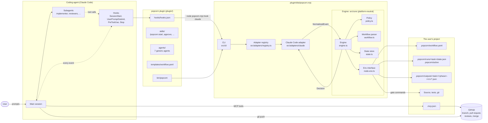
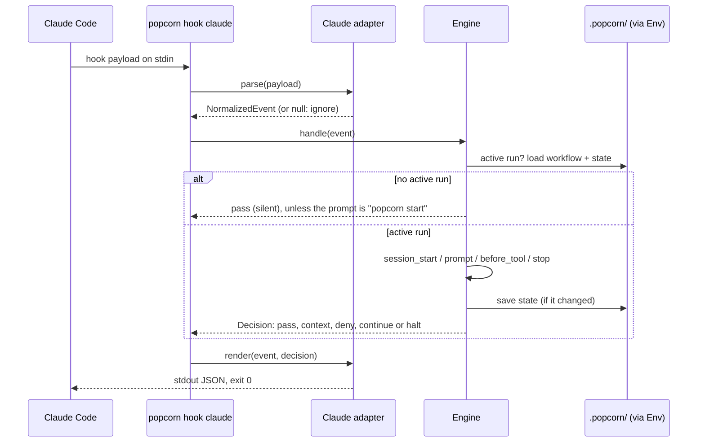
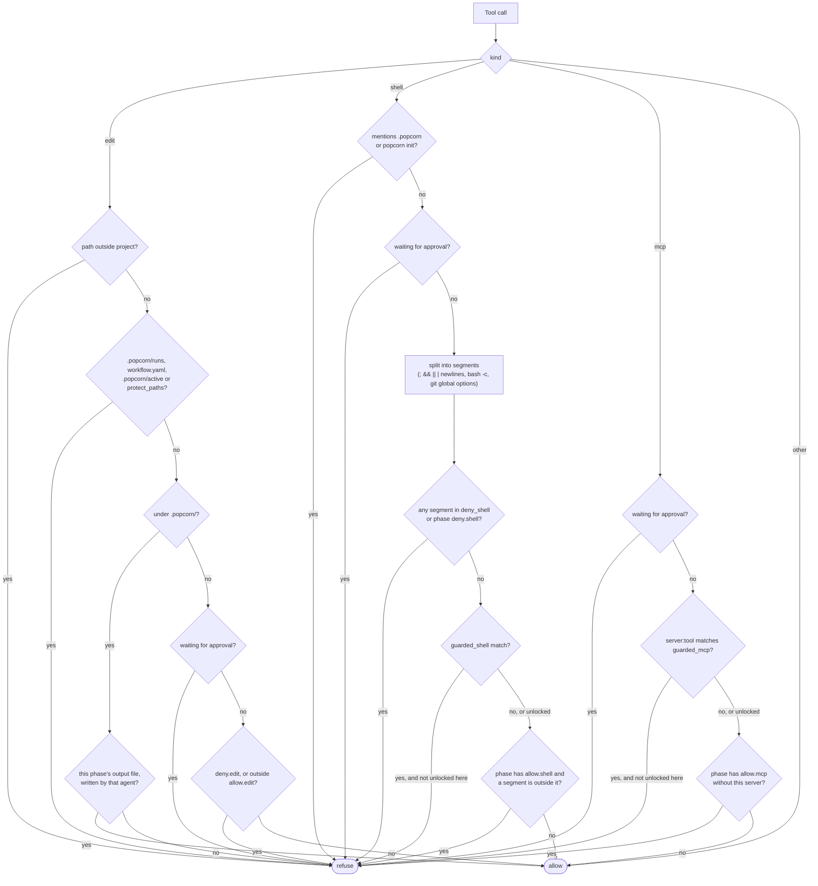
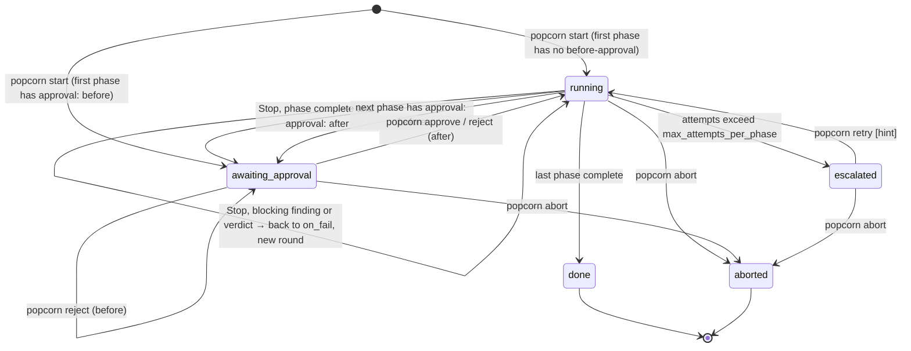

# Architecture

popcorn is one small Node.js program, bundled into `plugin/dist/popcorn.mjs`. The coding agent runs it on each hook event. It reads the workflow and the run's state from disk, decides, and prints the answer in the platform's format. It keeps no process running between events.

## Architecture diagram

The dashed arrows are hook events: Claude Code calls popcorn before it acts. popcorn never calls the agent; it only answers.

## Components

| Component | Where | Responsibility |
|---|---|---|
| Plugin | `plugin/` | What Claude Code installs: the hook wiring, slash-command skills, the generic agents, the starter workflow, the CLI wrapper and the committed bundle |
| CLI | `src/cli/` | `popcorn hook <adapter>`, `init`, `validate`, `start`, `status`. Has no approve command, on purpose |
| Adapter registry | `src/adapters/registry.ts` | Maps a platform name to its adapter. A new platform is one new entry |
| Claude Code adapter | `src/adapters/claude/` | Hook payload → `NormalizedEvent`; `Decision` → hook output JSON; resolves agent names (`.claude/agents/<name>.md` first, else `popcorn:<name>`); renders crashes as refusals |
| Engine | `src/core/engine.ts` | Routes events: starts runs, applies the user's commands, checks tool calls, and on Stop checks done-conditions and moves the run on |
| Policy | `src/core/policy.ts` | Pure function `checkTool`: allow a tool call, or return the reason to refuse it |
| Workflow | `src/core/workflow.ts` | Parses the YAML, validates it against a JSON Schema plus cross-references, validates agent outputs against the workflow's schemas |
| State store | `src/core/state.ts` | Reads and writes the run state and the active-run pointer |
| Env | `src/core/types.ts`, `node-env.ts` | Every side effect the engine needs (files, shell, clock). Injected, so tests use an in-memory `Env` |

### Boundaries

- **`src/core` knows no platform.** It imports nothing from `src/adapters` and names no agent product. Adapters translate; they hold no workflow logic.
- **All I/O goes through `Env`.** `checkTool` is pure: same workflow, state and call give the same answer.
- **The bundle is the product.** Claude Code runs `plugin/dist/popcorn.mjs` directly, so it is committed and rebuilt by `npm run check`.

## One hook event

| Event | What the engine does | Typical decision |
|---|---|---|
| `session_start` | Re-briefs the agent on the active phase | `context` |
| `prompt` | Applies `popcorn start/approve/reject/retry/abort/status`; otherwise re-briefs | `context` |
| `before_tool` | `checkTool` on the normalized call | `pass` or `deny` |
| `stop` | Checks done-conditions; moves to the next phase or back to `on_fail` | `continue` (keep working, with the next brief) or `halt` (let the agent stop and tell the user) |

**Fail safe.** The hook always exits 0, because Claude Code treats a failing hook as "allow". If the engine throws while a run is active, tool calls are refused with the error and the agent is allowed to stop. Without a `.popcorn/` directory, popcorn does nothing.

## How a tool call is checked

**Unlocked** means: the phase lists the pattern in `allow.guarded`, the run isn't waiting, the phase's `before` approval was granted this round (if it has `approval: before`), and its `unlock_after` phase passed in that phase's current round with every output saying `"verdict": "approve"` (if it names one).

Shell matching is best effort. A determined agent can disguise a command, which is why popcorn's state is also protected from the edit tools, and why branch protection and CI should stay in place.

## The run's state machine

Only the user's prompt moves a run out of `awaiting_approval` or `escalated`. The agent's only way forward is to finish the phase's work and end its turn.

## Files popcorn keeps

| Path | Written by | Purpose |
|---|---|---|
| `.popcorn/workflow.yaml` | The team (`popcorn init` copies the starter) | The workflow. Can't be edited during a run |
| `.popcorn/active` | Engine | The active run's task name, or empty |
| `.popcorn/runs/<task>/state.json` | Engine | Phase, status, rounds, attempts, approvals, passed phases, gate cache, history. Never writable by the agent |
| `.popcorn/outputs/<task>/<phase>-r<round>/<agent>.json` | Each required agent, for its own file only | Agent results, such as review verdicts, validated against the workflow's schema |

The state records:

- `rounds`: entries into each phase.
- `attempts`: stop attempts in the current round.
- `approvals`: keyed `<phase>#<round>#<before|after>`.
- `passed`: phases that completed with every output approving, and the round they passed in. `unlock_after` reads this.
- `gateCache`: the last result of each gate. A pass is reused while the working tree (HEAD, uncommitted changes and untracked files, minus `.popcorn/`) is unchanged; a failure is always rerun.
- `history`: every start, enter, complete, fail, approve, reject, retry, escalate and abort.
