# GitHub flow

The starter workflow (`plugin/templates/workflow.yaml`) makes every run visible on GitHub. The agent builds on a branch, opens a pull request, the reviewer agents' findings are posted on it, and the pull request is merged only once every reviewer approves. The user approves the plan (Design) and is not asked again.

## Phases

```mermaid
flowchart LR
    plan["Plan<br/>product-manager"] --> design["Design<br/>architect"]
    design -- "user: popcorn approve" --> build["Build<br/>implementer<br/>commits on popcorn/&lt;task&gt;"]
    build -- "gates pass" --> test["Test<br/>test-engineer"]
    test -- "gates pass" --> publish["Publish<br/>push branch, open PR"]
    publish -- "remote branch at HEAD" --> review["Review<br/>3 reviewers, posted on the PR"]
    review -- "a blocking finding or<br/>a reviewer not approving" --> build
    review -- "every reviewer approves" --> deploy["Deploy<br/>merge the PR"]
    deploy -- "branch in origin/main" --> done([done])
```



## Sequence

```mermaid
sequenceDiagram
    actor U as User
    participant A as Agent (main session)
    participant R as Reviewer subagents
    participant P as popcorn
    participant G as GitHub (MCP server or gh)

    U->>A: popcorn start p1-login Users can sign in
    A->>A: Plan, Design
    P-->>U: waiting for your approval (Design)
    U->>A: popcorn approve
    A->>A: Build and Test on popcorn/p1-login
    Note over P: git push is guarded; Publish unlocks it<br/>because Test passed (unlock_after: test)
    A->>G: git push -u origin popcorn/p1-login
    A->>G: create_pull_request
    P->>G: gate: remote branch == HEAD?
    A->>R: review git diff main...HEAD
    R->>P: each writes its verdict JSON to .popcorn/outputs/
    A->>G: one COMMENT review per reviewer
    alt any reviewer not approving, or a blocking finding
        P-->>A: back to Build with the findings
        A->>G: push fixes, comment what changed
    else every reviewer approves
        Note over P: Review recorded as passed.<br/>Deploy unlocks merge_pull_request (unlock_after: review)
        A->>G: merge_pull_request
        P->>G: gate: branch in origin/main?
        P-->>U: run complete
    end
```

## What unlocks what

| Phase | Unlocks (`allow.guarded`) | Unlocked by | Done when |
|---|---|---|---|
| Publish | `git push*` (pushes of `main`, `master`, `--all` and `--mirror` are refused, best effort) | `unlock_after: test` | The remote `popcorn/<task>` is at `HEAD` |
| Review | nothing | — | Every reviewer filed a valid verdict. `changes_requested` or a BLOCKER/CRITICAL/HIGH finding sends the run back to Build |
| Deploy | `*:merge_pull_request`, `gh pr merge*` | `unlock_after: review` (every verdict `approve`) | `popcorn/<task>` is an ancestor of `origin/main` |

Outside the phase that unlocks them, `policy.guarded_mcp` keeps the GitHub server's merge and direct-write tools refused: `merge_pull_request`, `push_files`, `create_or_update_file`, `delete_file`, `create_branch` and `update_pull_request_branch`. `gh pr merge` and `gh api` are guarded the same way. Patterns are `<server>:<tool>` with `*` as a wildcard, so the server can have any name in `.mcp.json`.

## Why the agent can't approve its own change

- **Verdicts.** Only a reviewer subagent can write its own verdict file, and shell commands can't touch `.popcorn/`.
- **Reviewers.** The starter workflow's `protect_paths` and `deny_shell` stop the agent from changing `.claude/agents/` (where a project's reviewer overrides live), `.claude/settings*.json` and `.mcp.json` during a run.
- **Fix rounds.** A fix round needs a fresh verdict file for the new round.

The limit: the main session writes each reviewer's prompt. To keep a human check before merging, add `approval: before` to Deploy; then both the user's approval and the reviewers' are needed.

## Setup

1. Add a GitHub MCP server to the project's `.mcp.json` (this repository's own `.mcp.json` is an example). The token comes from an environment variable:
   ```json
   {
     "mcpServers": {
       "github": {
         "type": "http",
         "url": "https://api.githubcopilot.com/mcp/",
         "headers": { "Authorization": "Bearer ${GITHUB_PERSONAL_ACCESS_TOKEN}" }
       }
     }
   }
   ```
2. Before starting Claude Code, export a token that can push and write pull requests, for example `export GITHUB_PERSONAL_ACCESS_TOKEN=$(gh auth token)`. Claude Code asks you to approve the project's MCP server on first use.
3. Protect `main` on GitHub. Popcorn's shell rules are best effort.
4. Check the server's real tool names. If it names merge or write tools differently from the list above, add them to `policy.guarded_mcp`.

Without an MCP server the phases' instructions fall back to the `gh` CLI.

**Reviews show the token owner's name.** The server acts as whoever owns the token, so reviews appear under that account. GitHub doesn't let a pull request's author approve their own pull request, so reviews are posted with event `COMMENT`. Popcorn decides from the JSON verdicts, not from GitHub's review state.
